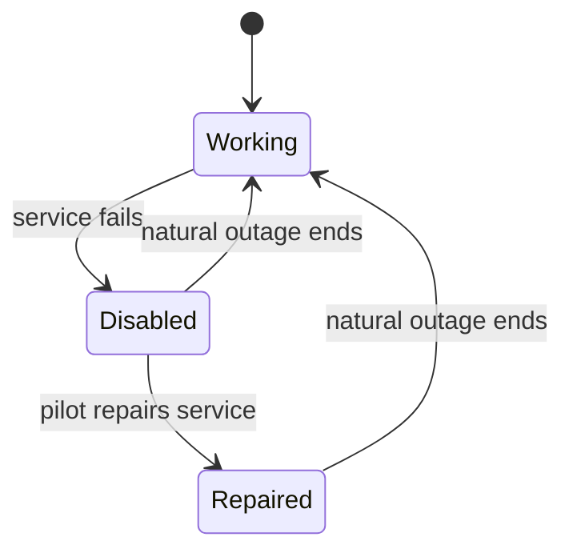

# Bounded protocol model

Refs #937. This four-tick abstraction explores operational budgets 1–2, two
pressure levels and one/two-tick outages. It checks phase accounting, preserved
outage ends, repair suppression and cursor ordering at anchor replacement. Work
accrues per tick in this abstraction; it does not prove that a settlement action
consumes the old interval before replacement. The separate arithmetic harness
exercises that behavior. This model does
not prove continuous arithmetic, stationary shares, FIFO behavior, migration,
serialization, multi-station independence or production code.

With TLC 1.7.4 and Java 11 or later, run from this directory:

```sh
java -cp /path/to/tla2tools.jar tlc2.TLC -workers 1 -config Outage.cfg Outage.tla
```

`Outage.cfg` must exit 0 with no invariant violation or deadlock. Replace it with
`ResetEnd.cfg`, `Resurrect.cfg` and `ReplaceFirst.cfg` in turn: those intentionally
broken protocols must each exit nonzero and name, respectively,
`OriginalEndPreserved`, `RepairNotResurrected` and `CursorBeforeReplace`.
Generated TLC state directories are scratch output, not tracked evidence.

The positive run checked 376 states and 898 steps. The Statechart projection
shows the pilot-visible phases:



The chart merges internal timing states and omits 651 same-label steps: pressure
changes, settlement, time within each phase and terminal stutters. No transition
between distinct visible phases is hidden. The graph is an abstraction of the
contract, not a trace of the game.
